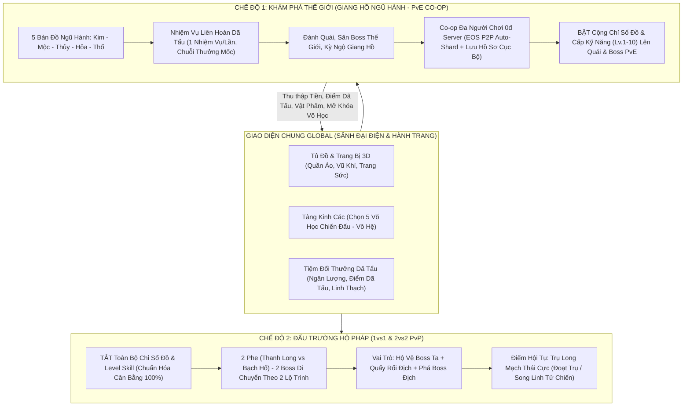
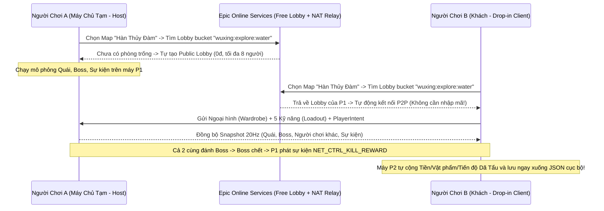

# THIẾT KẾ TỔNG THỂ & KẾ HOẠCH THỰC THI DÀI HẠN: NGŨ HÀNH TỶ VÕ
### Phiên bản 4.0 — Nền Tảng Game Thực Thụ: Khám Phá Thế Giới (Dã Tẩu Co-op 0đ Server) & Đấu Trường Song Linh Hộ Pháp (1v1 / 2v2 Công Bằng Tuyệt Đối)

---

# PHẦN A — TẦM NHÌN CỐT LÕI & KIẾN TRÚC TỔNG THỂ

## I. TẦM NHÌN DỰ ÁN & CHUYỂN DỊCH TỪ TESTBED SANG GAME THỰC THỤ

**Ngũ Hành Tỷ Võ (Wuxing Skills)** là tựa game hành động võ hiệp / tiên hiệp 3D góc nhìn Isometric, lấy cảm hứng từ triết lý Ngũ Hành biện chứng (Kim - Mộc - Thủy - Hỏa - Thổ) và Cảnh Giới Thái Cực.

Sau khi hoàn thiện nền tảng Engine (Vulkan `rlvk` / OpenGL, hệ thống VFX hạt/vải/nước, `entities/`, `combat/` Đấu Pháp 5×5, `boss/`, `ai/`, `formations/`, `character/` Wardrobe 3D, `net/` ENet + Epic Online Services P2P), dự án chính thức chuyển từ môi trường thử nghiệm (`SKILL_SANDBOX`, `VFX_TESTER`) sang **vòng lặp Gameplay hoàn chỉnh** gồm **1 Giao Diện Chuẩn Bị Global** và **2 Chế Độ Chơi Chính**:

1. **Giao Diện Chung Global (Sảnh Đại Điện, Tủ Đồ 3D & Tàng Kinh Các 5 Kỹ Năng):**
   - Nơi người chơi mặc trang phục, vũ khí, trang sức (`character/wardrobe_system.h`), đổi vật phẩm và lựa chọn **5 Võ Học chủ đạo** (`AGENT_SKILL_SLOTS = 5`) từ kho bí kíp đã học được để mang vào chiến đấu.
2. **Chế Độ 1 — Khám Phá Thế Giới ("Giang Hồ Ngũ Hành" - PvE Co-op 0đ Server):**
   - Người chơi tự do chọn tiến vào **5 Bản Đồ Ngũ Hành (Kim, Mộc, Thủy, Hỏa, Thổ)** để du ngoạn, đánh quái, săn Boss, và làm **Nhiệm Vụ Liên Hoàn Dã Tẩu** (mỗi lần chỉ nhận 1 nhiệm vụ, hoàn thành mới mở nhiệm vụ kế tiếp giống Dã Tẩu trong *Võ Lâm Truyền Kỳ*).
   - Hỗ trợ **nhiều người chơi tham gia chung trên một bản đồ hoàn toàn miễn phí (0đ chi phí Server)** thông qua kiến trúc **EOS P2P Auto-Sharding + Lưu Hồ Sơ Cục Bộ**.
   - Thu thập **Ngân Lượng (tiền)**, **Điểm Dã Tẩu**, **Ngũ Hành Linh Thạch (vật phẩm)** để mở khóa quần áo, trang sức, vũ khí, võ học mới và **luyện cấp kỹ năng (Lv.1 $\rightarrow$ Lv.10)**.
3. **Chế Độ 2 — Đấu Trường Hộ Pháp ("Song Linh Tranh Hùng" - PvP 1vs1 & 2vs2):**
   - Chia làm **2 Phe (Thanh Long vs Bạch Hổ)** với 2 thể thức **1vs1** và **2vs2**.
   - Mỗi phe bảo vệ **1 Đại Tinh Linh Boss của phe mình** di chuyển dọc theo **2 lộ trình riêng biệt** tiến về **Điểm Hội Tụ Trung Tâm (Trụ Long Mạch Thái Cực)**.
   - Vai trò của người chơi: **Hộ tống & bảo vệ Boss phe mình**, **Quấy rối & tiêu diệt người chơi phe địch**, và **Công kích / khống chế Boss địch hoặc công phá Trụ Long Mạch**.
4. **Quy Tắc Vàng Về Cân Bằng ("Cày Nhiều Không Bá, Chơi Ít Không Thọt"):**
   - **Toàn bộ chỉ số cộng thêm từ Trang Bị (Quần áo, Vũ khí, Trang sức) và Cấp Độ Kỹ Năng (Skill Level 1–10) CHỈ CÓ TÁC DỤNG LÊN QUÁI VÀ BOSS TRONG CHẾ ĐỘ KHÁM PHÁ THẾ GIỚI (PvE).**
   - **Khi bước vào Chế Độ Đấu Nhau (PvP 1vs1 & 2vs2), mọi chỉ số cộng thêm và cấp độ kỹ năng đều bị vô hiệu hóa / chuẩn hóa về mức cơ bản 100% (`HP = 100`, `Mana = 100`, `Skill Level = 1`).** Ngoại hình quần áo, vũ khí và sự đa dạng của các bộ Võ Học đã mở khóa vẫn được giữ nguyên, đảm bảo tính công bằng tuyệt đối cho mọi trận so tài kỹ năng!



---

## II. NỀN TẢNG VÕ HỌC CỐT LÕI (NGŨ HÀNH, VÔ HỆ, ĐẤU PHÁP & THÁI CỰC)

### 1. Hệ Thống "Vô Hệ" Với 5 Ô Kỹ Năng (`AGENT_SKILL_SLOTS = 5`)
* Người chơi không bị khóa chết vào một môn phái từ đầu. Từ kho Võ Học đã học được qua Chế độ Khám Phá, người chơi được chọn **5 Kỹ Năng** lắp vào 5 ô chiến đấu (Phím `1, 2, 3, 4, 5` trên PC / 5 nút cảm ứng `UITouchSkillSlot[5]` trên Mobile).
* **Đồng Hóa Thuộc Tính (Vô Hệ):** Hệ hiện tại của nhân vật (`currentElement`) tự động kết tinh theo **nguyên tố chiếm đa số** trong 5 chiêu thức đang trang bị.
* **Đột Phá Cảnh Giới Thái Cực (Đại Trận Lưỡng Nghi):**
  * **Điều kiện kích hoạt:**
    1. *Theo Bộ Chiêu Cân Bằng:* Trang bị đủ 5 ô đạt thế cân bằng Âm Dương: **2 Âm (Thủy/Mộc) + 2 Dương (Hỏa/Kim) + 1 Trung Hòa (Thổ)**.
    2. *Theo Ngộ Tính Chiến Đấu (Combo Tương Sinh):* Tung liên tiếp 3 chiêu thức đúng vòng **Ngũ Hành Tương Sinh** (Thủy $\rightarrow$ Mộc $\rightarrow$ Hỏa $\rightarrow$ Thổ $\rightarrow$ Kim $\rightarrow$ Thủy) trúng mục tiêu trong vòng 6 giây để kích hoạt Thái Cực tức thời!
  * **Hiệu ứng Thái Cực:** Toàn bộ thế giới chuyển sang Shader Đơn Sắc (Trắng - Đen). Nhân vật miễn nhiễm khắc chế nguyên tố và mở khóa 2 Tuyệt học tối thượng:
    * **PHONG (Gió - Nhu):** Tạo cuồng phong hút gom kẻ địch, quái nhỏ và phế bỏ đạn đạo xung quanh vào tâm bão.
    * **LÔI (Điện - Cương):** Giáng thiên lôi tím trắng xuống tâm bão gây sát thương chí mạng diện rộng (tiêu hao mạnh Linh Khí; khi cạn sạch Mana sẽ tự thoát khỏi Thái Cực).

### 2. Khinh Công, Thiền Định & Vật Lý Trục $Y/Z$ (Ring-Out)
* **Khinh Công & Đòn Đánh Thường:** Người chơi có thể Nhảy (`SPACE`), Lướt Khinh Công để lại dư ảnh (`LSHIFT`), và xuất chiêu Cận chiến Đấm / Đá / Chưởng (`Z / C / Chuột phải`) hoàn toàn không tốn Mana, kết hợp cộng hưởng với Tường Nguyên Tố (`SkillManager_FindNearbyWall`).
* **Thiền Định Vận Công (`Phím G`):** Xả chiêu tốc độ cao (Fast Cooldown) làm cạn Mana rất nhanh. Khi cạn Linh Khí, người chơi phải tìm góc khuất, ấn Vận Công (đứng yên 3 giây) để hồi đầy bình Mana (`34 Mana/s`). Bị trúng đòn hoặc di chuyển sẽ làm đứt mạch vận công.
* **Cơ Chế Rớt Vực (Ring-Out):** Các khu vực đài đá cao hoặc mép vực có giới hạn bán kính. Khi bị trúng chiêu đẩy lùi mạnh (Knockback Force) văng ra khỏi rìa, thực thể sẽ rơi tự do và bị tiêu diệt ngay lập tức.

### 3. Đấu Pháp Projectile (5×5 Clash Matrix) & Địa Hình Tĩnh (Virtual Triggers)
* **Đấu Pháp Tầm Xa (`combat/`):** Mọi kỹ năng đạn đạo (Projectile) bay trên sân đều đăng ký va chạm thực thời gian thực qua ma trận **Tương Khắc 5×5**:
  * **Thủy khắc Hỏa $\rightarrow$ Hỏa khắc Kim $\rightarrow$ Kim khắc Mộc $\rightarrow$ Mộc khắc Thổ $\rightarrow$ Thổ khắc Thủy.**
  * Đạn hệ khắc sẽ nghiền nát đạn hệ bị khắc và tiếp tục bay tới mục tiêu! Đạn cùng hệ hoặc không khắc sẽ tự nổ triệt tiêu lẫn nhau.
* **Vùng Địa Hình Tĩnh (`maps/map_manager.h` & `game/game_rules.h`):** Địa hình giữ nguyên hình ảnh tĩnh để tối ưu hiệu năng 60 FPS nhưng chứa các vùng nguyên tố ẩn (`MapZone`):
  * **Khúc Sông (`NAT_RIVER`):** Giảm 50% hồi chiêu hệ Thủy; giảm 50% sát thương hệ Hỏa.
  * **Rừng Rậm (`NAT_FOREST`):** Giúp hệ Mộc ẩn thân (Stealth) khi đứng yên; giảm 50% sát thương đạn hệ Thổ bay qua rừng.
  * **Bãi Cát / Đá Khô (`NAT_DESERT_ZONE`):** Tăng 50% lực đẩy lùi (Knockback) cho hệ Thổ; giảm 50% tầm bay của chiêu hệ Thủy.

---

# PHẦN B — THIẾT KẾ CHI TIẾT CHẾ ĐỘ 1: KHÁM PHÁ THẾ GIỚI ("GIANG HỒ NGŨ HÀNH")

## III. 5 BẢN ĐỒ NGŨ HÀNH (NGŨ HÀNH BÍ CẢNH)

Khi chọn Chế độ Khám Phá Thế Giới, người chơi được mở **Bản Đồ Giang Hồ Ngũ Hành** để chọn tiến vào 1 trong 5 vùng đất đặc trưng (nơi quái vật, Boss và nguyên liệu rơi ra mang đậm thuộc tính của vùng đó):

| STT | Tên Bản Đồ | Hệ Chủ Đạo | Đặc Trưng Cảnh Quan & Vùng Địa Hình (`MapZone`) | Loại Quái & Nguyên Liệu Đặc Sản |
|---|---|---|---|---|
| 1 | **Hàn Thủy Đàm** | **Thủy (Water)** | Thung lũng sông suối uốn lượn (`song_quao`), hồ nước sâu, bờ cỏ lau trắng, sương mù sát mặt nước, nhiều vùng `NAT_RIVER`. | Thủy Yêu, Hàn Băng Tinh, Boss Hải Hồn Linh $\rightarrow$ Rớt *Hàn Thủy Tinh Hạch*. |
| 2 | **Thanh Mộc Lâm** | **Mộc (Wood)** | Thảo nguyên rừng xanh bạt ngàn (`verdant_path` / `song_quao` biến thể Lush), hoa dại, vệt nắng xuyên tán cây (God-rays), nhiều vùng `NAT_FOREST`. | Mộc Tinh, Độc Đằng Yêu, Boss Thần Mộc Linh $\rightarrow$ Rớt *Thanh Mộc Linh Diệp*. |
| 3 | **Xích Hỏa Sơn** | **Hỏa (Fire)** | Thung lũng cỏ cháy rụi và tàn lửa đỏ rực (`MAP_GRASS_STATE_SCORCHED`), đá núi lửa nứt đỏ, nhiều vùng `NAT_DESERT_ZONE`. | Hỏa Viêm Quỷ, Dung Nham Quái, Boss Thạch Nham Linh $\rightarrow$ Rớt *Xích Hỏa Tinh Thạch*. |
| 4 | **Hoàng Thổ Đài** | **Thổ (Earth)** | Cao nguyên đá sa mạc khô cằn (`ninh_thuan` / `MAP_GRASS_STATE_DRY`), cột đá cổ đại và bình nguyên gió cát, vùng `NAT_DESERT_ZONE`. | Thạch Nhân, Sa Mạc Khôi Lỗi, Boss Hắc Diện Tôn Giả $\rightarrow$ Rớt *Hoàng Thổ Huyền Khoáng*. |
| 5 | **Kim Tuyệt Cốc** | **Kim (Metal)** | Đài đá cheo leo giữa biển mây (`default_arena` mở rộng + cụm đá nhọn `MAP_ROCK_CRAG`), kiếm khí cổ xưa vương vấn. | Kiếm Hồn, Kim Giáp Vệ, Boss Diệt Linh Kích $\rightarrow$ Rớt *Bạch Kim Tinh Thiết*. |

---

## IV. HỆ THỐNG NHIỆM VỤ LIÊN HOÀN "DÃ TẨU" (VÕ LÂM TRUYỀN KỲ STYLE)

Trái tim tạo nên sự cuốn hút dài hạn của Chế độ Khám Phá là hệ thống **Nhiệm Vụ Liên Hoàn Dã Tẩu (`game/quest_datau.h/.c`)**:

### 1. Luật Chơi Cốt Lõi
* **Mỗi lần chỉ nhận duy nhất 1 nhiệm vụ:** Người chơi không bị ngợp bởi hàng chục dấu chấm than. Trên góc màn hình luôn chỉ có **1 Mục Tiêu Dã Tẩu** rõ ràng, ngắn gọn (thời gian hoàn thành chỉ từ **1 đến 3 phút**).
* **Tự động nối chuỗi (Chain Progression):** Ngay khi hoàn thành nhiệm vụ thứ $N$, hiệu ứng hoàn thành bùng nổ, phần thưởng (Ngân Lượng + Điểm Dã Tẩu + EXP Kỹ năng) bay thẳng vào hành trang và Dã Tẩu lập tức giao nhiệm vụ thứ $N+1$.
* **Chuỗi Liên Hoàn (`daTauStreak`) & Bảo Rương Mốc Thưởng:**
  * Hoàn thành liên tiếp sẽ tích lũy chuỗi: `Chuỗi 1 -> 2 -> 3 ... -> 100`.
  * Nếu gặp nhiệm vụ chưa muốn làm, người chơi có thể dùng **"Lệnh Bài Dã Tẩu"** (nhặt được khi đánh Boss) để **Đổi Nhiệm Vụ Khác mà giữ nguyên chuỗi**, hoặc chọn **Hủy Chuỗi** (quay về mốc 1).
  * **Mốc Đại Thưởng (Chuỗi 5, 10, 20, 30, 50, 100):** Ngoài tiền và điểm thông thường, đạt mốc chuỗi sẽ thưởng **Rương Hoàng Kim Dã Tẩu** mở ra:
    * **Bí Kíp Võ Học Mới** (mở khóa kỹ năng mới trong Tàng Kinh Các).
    * **Trang Phục / Vũ Khí / Mặt Nạ / Nón Hiếm** trong Tủ Đồ.
    * Lượng lớn **Điểm Dã Tẩu** và **Ngũ Hành Linh Thạch**.

### 2. 5 Nhóm Nhiệm Vụ Dã Tẩu Biến Hóa Khôn Lường
Để việc làm nhiệm vụ luôn dồn dập, bất ngờ và không bao giờ nhàm chán, thuật toán sinh nhiệm vụ của Dã Tẩu xoay vòng thông minh giữa 5 dạng thử thách:

1. **Nhiệm vụ Trừ Yêu (Slay Hunt):**
   * *Ví dụ:* "Tiêu diệt 12 Tiểu Yêu hệ Hỏa tại Xích Hỏa Sơn" hoặc "Tiêu diệt 8 Pháp Yêu ở bất kỳ bản đồ nào".
2. **Nhiệm vụ Tương Khắc & Ngộ Đạo (Elemental Mastery):**
   * *Ví dụ:* "Dùng chiêu thức **Hệ Thủy** kết liễu 6 quái vật **Hệ Hỏa**" hoặc "Kích hoạt **Đấu Pháp** bắn nổ 5 viên đạn của Pháp Yêu".
   * Giúp người chơi rèn luyện phản xạ tương khắc tự nhiên để chuẩn bị cho PvP!
3. **Nhiệm vụ Tầm Bảo & Thu Thập (Relic Collection):**
   * *Ví dụ:* "Thu thập 5 *Hàn Thủy Tinh Hạch* rơi ra từ quái vật hoặc mọc quanh bờ sông Hàn Thủy Đàm".
4. **Nhiệm vụ Trấn Thủ Long Mạch (Survival Ambush - Cực kỳ kịch tính):**
   * *Ví dụ:* "Đến khu vực Rừng Cổ Thụ (`NAT_FOREST`), kích hoạt Long Trụ và sống sót qua 3 đợt quái vật vây công điên cuồng trong 30 giây!".
5. **Nhiệm vụ Trảm Tà Tinh Linh (Boss / Elite Trial - Xuất hiện ở các mốc chuỗi chia hết cho 5):**
   * Ngay khi nhận nhiệm vụ, một con **Tinh Linh Thủ Lĩnh (Mini-Boss hoặc Đại Tinh Linh Boss)** giáng thế gần vị trí người chơi kèm cột sáng báo hiệu toàn bản đồ. Những người chơi khác trong cùng bản đồ có thể chạy lại đánh phụ để cùng nhận thưởng!

---

## V. KIẾN TRÚC MULTIPLAYER KHÁM PHÁ "0 ĐỒNG CHI PHÍ SERVER"

Làm sao để nhiều người chơi cùng vào bản đồ Kim/Mộc/Thủy/Hỏa/Thổ, thấy nhau, cùng đánh quái, cùng săn Boss mà **không tốn một đồng thuê Server hay Database**?



1. **Tận Dụng Hạ Tầng Miễn Phí 100% Của Epic Online Services (EOS Lobbies + P2P Relay):**
   * Đã tích hợp sẵn trong `net/net_eos.c` với cơ chế đăng nhập ẩn danh `Device ID` (người chơi không cần tạo tài khoản Epic).
   * Mỗi bản đồ trong 5 bản đồ Ngũ Hành được định danh bằng một `Bucket ID` riêng biệt:
     * `wuxing:explore:water`, `wuxing:explore:wood`, `wuxing:explore:fire`, `wuxing:explore:earth`, `wuxing:explore:metal`.
2. **Cơ Chế "Tự Động Vào Kênh Hoặc Tự Mở Kênh" (`Net_JoinOrHostExploreRealm`):**
   * Khi người chơi bấm vào bản đồ **Hàn Thủy Đàm**:
     * Game tự động tìm trên EOS xem có phòng công khai nào của `wuxing:explore:water` đang mở và có số người `< 8` (`NET_MAX_PLAYERS = 8`) hay không.
     * **Nếu có:** Tự động kết nối P2P vào phòng đó (không cần nhập mã phòng!). Người chơi lập tức xuất hiện trong bản đồ cùng với những người chơi đang có mặt ở đó.
     * **Nếu chưa có (hoặc các kênh đều đã đủ 8 người):** Máy của người chơi lập tức tự mở một Lobby công khai mới cho bản đồ đó và vào chơi ngay trong 1 giây. Những người chơi khác bấm vào bản đồ sau đó sẽ tự động được ghép vào thế giới của bạn!
3. **Cơ Chế Lưu Trữ Phi Tập Trung & Chống Mất Dữ Liệu Khi Host Thoát:**
   * **Không tốn tiền thuê Database Server:** Toàn bộ hồ sơ nhân vật (`PlayerProfile` + `PlayerWardrobe`: tiền, điểm Dã Tẩu, linh thạch, cấp độ skill, quần áo đã mở khóa) được lưu trực tiếp thành file JSON trên thiết bị của từng người chơi (`assets/saves/player_profile.json`), được bảo vệ bằng mã băm kiểm tra toàn vẹn (`CRC32/HMAC`).
   * **Chia sẻ công bằng không tranh cướp (Co-op Loot):** Trong chế độ Khám Phá, mọi người chơi đều thuộc phe Đồng Minh (`TEAM_ALLY`), chỉ có Quái và Boss thuộc `TEAM_ENEMY`. Khi một con quái hoặc Boss bị tiêu diệt trên máy Host, Host phát gói tin `NET_CTRL_KILL_REWARD` cho tất cả người chơi đứng gần hoặc có tham gia gây sát thương $\rightarrow$ ai cũng nhận được tiền, vật phẩm và tính điểm nhiệm vụ Dã Tẩu!
   * **Chuyển Tiếp Mượt Mà Khi Chủ Phòng (Host) Thoát:** Vì mỗi lần nhặt tiền, lên cấp skill hay xong nhiệm vụ Dã Tẩu đều được lưu ngay lập tức trên máy của từng người chơi, nếu Host đột ngột thoát mạng, các người chơi còn lại **không mất bất kỳ tiến trình nào** và thế giới trên máy họ tự động chuyển sang chế độ độc lập (Local Host) ngay tại vị trí đang đứng!

---

# PHẦN C — THIẾT KẾ CHI TIẾT CHẾ ĐỘ 2: ĐẤU TRƯỜNG HỘ PHÁP (1vs1 & 2vs2 PvP)

## VI. CẤU TRÚC TRẬN ĐẤU "SONG LINH HỘ PHÁP" (1vs1 & 2vs2)

Chế độ Đấu Nhau được thiết kế để mang lại cảm giác **hồi hộp, dồn dập, giằng co từng mét đất và bùng nổ bất ngờ**, đồng thời **công bằng tuyệt đối 100%**.

```mermaid
flowchart LR
    subgraph BASE_A["Căn Cứ Phe Thanh Long (Team 0)"]
        SpawnA["Điểm Hồi Sinh Anh Hùng A"]
        BossA["Boss Thanh Long Hộ Pháp"]
    end

    subgraph LANE_TOP["Lộ Trình Bắc (Qua Khúc Sông - Thủy)"]
        W1["Waypoint A1"] --> W2["Waypoint A2"]
    end

    subgraph CENTER["ĐIỂM HỘI TỤ: ĐÀI THÁI CỰC"]
        Pillar["TRỤ LONG MẠCH THÁI CỰC\n(Điểm Giao Tranh Quyết Định)"]
    end

    subgraph LANE_BOT["Lộ Trình Nam (Qua Rừng & Cát - Mộc/Thổ)"]
        E2["Waypoint B2"] <-- E1["Waypoint B1"]
    end

    subgraph BASE_B["Căn Cứ Phe Bạch Hổ (Team 1)"]
        SpawnB["Điểm Hồi Sinh Anh Hùng B"]
        BossB["Boss Bạch Hổ Hộ Pháp"]
    end

    BossA --> W1
    W2 --> Pillar
    BossB --> E1
    E2 --> Pillar
```

### 1. Hai Phe, Hai Boss Hộ Pháp & Hai Lộ Trình Hội Tụ
* **Thể thức:** **1vs1** (1 người chơi mỗi phe) hoặc **2vs2** (2 người chơi mỗi phe; có thể thêm Bot Anh Hùng `AI_SpawnHeroBot` nếu muốn luyện tập hoặc thiếu người).
* **Hai Phe Đối Kháng:**
  * **Phe Thanh Long (`TEAM_ALLY` - Sắc Xanh Lam Ngọc):** Xuất phát từ Đài Thanh Long.
  * **Phe Bạch Hổ (`TEAM_ENEMY` - Sắc Đỏ Chu Sa / Hổ Phách):** Xuất phát từ Đài Bạch Hổ.
* **Hai Đại Tinh Linh Boss Di Chuyển Theo Lộ Trình (`BossRoute`):**
  * Ngay khi hết 3 giây đếm ngược mở màn, mỗi phe triệu hồi **1 Đại Tinh Linh Boss Hộ Pháp** (máu khởi điểm `1500 HP`, tự động biến đổi hệ Ngũ Hành qua 4 mốc máu `100% / 75% / 50% / 25%` và triệu hồi lính tinh linh nhỏ `ARCH_MINION`).
  * **2 Lộ Trình Khác Nhau Nhưng Giao Nhau Ở Đích:**
    * Boss Thanh Long tiến theo **Lộ trình cánh Bắc** (đi qua vùng Sông Nước `NAT_RIVER` và Hẻm Đá).
    * Boss Bạch Hổ tiến theo **Lộ trình cánh Nam** (đi qua vùng Rừng Cây `NAT_FOREST` và Bãi Cát `NAT_DESERT_ZONE`).
    * Cả 2 lộ trình đều hội tụ về đúng **1 Điểm Gặp Nhau Duy Nhất ở trung tâm bản đồ: "Trụ Long Mạch Thái Cực"**.

### 2. Ba Vai Trò Chiến Thuật Của Người Chơi (Tam Giác Chiến Thuật)
Trong suốt trận đấu, người chơi (đặc biệt là cặp đôi 2vs2) phải liên tục đọc tình huống và chuyển đổi linh hoạt giữa 3 nhiệm vụ:

1. **Hộ Vệ Boss Phe Mình (Escort & Empower):**
   * Khi người chơi đứng trong vòng **Hộ Pháp ($6\text{m}$)** quanh Boss phe mình và không có kẻ địch cản đầu:
     * Boss phe mình nhận hiệu ứng **Thuận Phong Hành Quân**: Tăng **+25% tốc độ di chuyển** tiến về Trụ Long Mạch và giảm **15% sát thương gánh chịu**.
   * Dùng kỹ năng hệ Thủy/Thổ hoặc Trận Pháp để chắn đạn (Đấu Pháp), giải vây và tiêu diệt lính cảm tử (`ARCH_MINION`) của địch đang lao vào Boss mình.
2. **Quấy Rối & Cầm Chân Phe Địch (Harass & Delay):**
   * Chủ động sang phần đường của Boss địch để **phá thế hộ tống** của đối phương.
   * Dùng kỹ năng khống chế (Làm chậm `Entity_AddModifier`, Đóng băng / Choáng `Entity_ApplyStun`, Hút `Entity_ApplyPull`, Tường Đá `STONE_PRISON`) để **cầm chân Boss địch**, khiến Boss địch đi chậm lại hoặc dừng bước chiến đấu!
3. **Tập Kích Boss Địch & Đoạt Trụ Trung Tâm (Boss Burn & Pillar Rush):**
   * Nhìn chuẩn màu hoa văn Ngũ Hành hiện tại trên người Boss địch để tung chiêu **Tương Khắc** gây sát thương chí mạng lên Boss địch, hoặc canh lúc Boss địch đi ngang mép vực để dồn lực đẩy lùi (Knockback) hất Boss địch rơi vực!

### 3. Cơ Chế Tại Điểm Hội Tụ ("Trụ Long Mạch Thái Cực") & Điều Kiện Thắng Thua
Tại điểm gặp nhau cuối cùng của 2 lộ trình là **Trụ Long Mạch Thái Cực** — kiến trúc cổ đại nắm giữ sinh mệnh của cả đấu trường:

* **Điều Kiện Thắng Tức Thì (Knockout — Bất kỳ lúc nào trong trận):**
  * Phe nào **tiêu diệt được Boss của đối phương về 0 HP** (hoặc đẩy Boss đối phương rơi khỏi đài đá Ring-Out) $\rightarrow$ **THẮNG NGAY LẬP TỨC!**
* **Khi 1 Trong 2 Boss Đến Điểm Hội Tụ Trước (Phần Thưởng Cho Phe Hộ Tống Tốt Hơn):**
  * Nếu Boss phe bạn chạm tới **Trụ Long Mạch** trước (nhờ bạn hộ tống nhanh hơn hoặc làm chậm Boss địch thành công), Boss của bạn lập tức **Chiếm Quyền Trụ Long Mạch**:
    * Trụ Long Mạch phát sáng theo màu phe bạn, mỗi 3 giây giáng một đạo **Thiên Lôi Long Mạch** trừ thẳng máu của Boss địch từ xa và cấp lá chắn cho người chơi phe bạn!
    * Người chơi phe bạn lúc này cũng có thể trực tiếp tấn công vào **Trụ Long Mạch** để tích điểm **Phá Trụ / Đoạt Long Khí**.
* **Khi Cả 2 Boss Chạm Mặt Tại Điểm Hội Tụ ("Song Linh Tử Chiến"):**
  * Khi cả 2 Boss cùng bước vào vòng hội tụ quanh Trụ Long Mạch, chúng dừng hành quân và **trực tiếp tung chiêu đại chiến với nhau** đồng thời xả kỹ năng diện rộng quanh Trụ!
  * Nếu một trong hai Boss tụt xuống dưới **30% HP** (hoặc khi thời gian trận đấu bước vào 60 giây cuối — **Huyết Chiến Thái Cực**), bầu trời chuyển sang Đơn Sắc Trắng - Đen, cả Boss lẫn Trụ Long Mạch bước vào trạng thái quá tải!
  * **Phân Định Thắng Thua Khi Hết Giờ / Phá Trụ:**
    * Nếu Trụ Long Mạch bị một phe đánh sập hoàn toàn (100% Thanh Chiếm Đóng / Phá Hủy Trụ) $\rightarrow$ Trụ phát nổ tiêu diệt Boss phe địch $\rightarrow$ **Phe Phá Trụ Chiến Thắng!**
    * Nếu hết thời gian thi đấu (ví dụ 4 phút) mà chưa Boss nào gục: Phe nào có **Tổng Điểm Công Phá (Tổng sát thương gây lên Boss Địch + Sát thương gây lên Trụ Long Mạch)** cao hơn sẽ giành chiến thắng! (Được hiển thị trực quan bằng **Thanh Kéo Co Long Hổ** ngay chính giữa đỉnh màn hình).

### 4. Nhịp Độ Dồn Dập & Yếu Tố Bất Ngờ Trong PvP
Để trận đấu luôn kịch tính từ giây đầu đến giây cuối:
* **Hồi Sinh Nhanh & Phản Phệ Hộ Pháp:**
  * Người chơi bị hạ gục trong PvP **không bị loại khỏi ván đấu** mà sẽ hồi sinh sau **5 giây** tại căn cứ kèm hiệu ứng **Khinh Công Truy Kích (+60% tốc độ chạy trong 4 giây)** để lao ngay ra chiến trường.
  * Tuy nhiên, mỗi lần người chơi bị hạ gục sẽ gây **Phản Phệ Hộ Pháp**: Boss của phe đó bị **Choáng 2.5 giây** và chịu một đòn sét phản phệ mất **6% máu tối đa**! Nhờ đó, việc solo hạ gục người chơi đối phương có tác động cực lớn đến cục diện đường đi của Boss!
* **Dị Tượng Ngũ Hành (Mỗi 60 Giây):**
  * Cứ mỗi 60 giây, tại các giao lộ trên bản đồ xuất hiện **Kỳ Trân Ngũ Hành (Linh Châu)**: Phe nào nhanh chân đoạt được sẽ giúp Boss phe mình **Hồi 10% HP + Tăng 40% tốc độ hành quân trong 12 giây** hoặc mở khóa tạm thời **Cảnh Giới Thái Cực** cho người nhặt!
* **Thưởng Phản Xạ Đấu Pháp (Clash Adrenaline):**
  * Khi người chơi bắn đạn khắc chế nổ tung đạn của đối phương (`CLASH_A_WINS`), chiêu thức đó được **giảm ngay 50% thời gian hồi chiêu và hồi lại 15 Mana**, tạo nên những màn đấu phép đối đòn mãn nhãn liên hoàn!

---

# PHẦN D — GIAO DIỆN CHUNG GLOBAL & HỆ THỐNG CÂN BẰNG TUYỆT ĐỐI

## VII. GIAO DIỆN HÀNH TRANG, TỦ ĐỒ & TÀNG KINH CÁC GLOBAL (`ui/ui_hub.h/.c`)

Giao diện chuẩn bị của người chơi là **Global (Toàn Cục)** — dùng chung xuyên suốt mọi chế độ (có thể mở ngay tại Màn Hình Chính, trong Khu An Toàn của Map Khám Phá, hoặc trong Sảnh Chờ trước trận PvP):

1. **Tab 1 — Tủ Đồ & Ngoại Trang 3D (`ui/ui_wardrobe.h`):**
   * Sân khấu nhân vật 3D xoay 360 độ với hiệu ứng vải bay vật lý (`SpringBoneSystem`).
   * Trang bị 13 vị trí (`ModularSlot`): Đầu, Tóc, Nón Lá/Mũ, Mặt Nạ, Áo Giao Lĩnh, Quần Võ Hiệp, Chiến Hài, Hộ Uyển, Đai Lưng, Vỏ Kiếm Sau Lưng, Vũ Khí Tay Phải/Trái, hoặc Nguyên Bộ Trường Bào.
   * Tự động đồng bộ Thế Võ (`CombatStance`): Cầm Kiếm (`COMBAT_STANCE_SWORD`) hay Tay Không (`COMBAT_STANCE_UNARMED`).
2. **Tab 2 — Tàng Kinh Các & Bảng Chọn 5 Võ Học (`5-Skill Loadout`):**
   * Hiển thị toàn bộ danh sách Võ Học thuộc 5 hệ: **Thủy, Mộc, Hỏa, Thổ, Kim**.
   * Những Võ Học chưa học sẽ hiển thị điều kiện mở khóa (ví dụ: *"Đổi tại Tiệm Dã Tẩu 200 điểm"* hoặc *"Hoàn thành mốc 20 nhiệm vụ Dã Tẩu"*).
   * Người chơi chọn **5 Kỹ Năng** lắp vào 5 ô chiến đấu (`Phím 1..5`).
   * Giao diện tự động báo:
     * **Hệ Chủ Đạo hiện tại (Vô Hệ)** dựa trên 5 chiêu đã chọn.
     * Trạng thái **Cân Bằng Âm Dương (Thái Cực)** nếu tổ hợp 5 chiêu đạt chuẩn (2 Âm + 2 Dương + 1 Thổ).
     * Hiển thị song song **Chỉ Số Khám Phá (PvE - Theo Cấp Độ Kỹ Năng Lv.1–10)** và **Chỉ Số Thi Đấu (PvP - Chuẩn Hóa Lv.1)**.
3. **Tab 3 — Tiệm Đổi Thưởng Dã Tẩu (Exchange & Crafting Shop):**
   * Hiển thị số dư: **Ngân Lượng**, **Điểm Dã Tẩu**, và **5 loại Ngũ Hành Linh Thạch**.
   * Cho phép đổi trực tiếp lấy Quần Áo, Trang Sức, Vũ Khí, và Bí Kíp Võ Học mới, tự động lưu vào `player_wardrobe.json` và `player_profile.json`.

## VIII. BẢNG SO SÁNH CƠ CHẾ TÁCH BIỆT PvE (KHÁM PHÁ) VÀ PvP (ĐẤU NHAU)

| Thuộc Tính / Cơ Chế | Chế Độ 1: Khám Phá Thế Giới (PvE Co-op) | Chế Độ 2: Đấu Trường Hộ Pháp (PvP 1v1 & 2v2) |
|---|---|---|
| **Chỉ số Quần áo, Trang sức, Vũ khí (`WardrobeItemStats`)** | **CÓ HIỆU LỰC 100%** (+HP, +Mana, +Tốc chạy, +Sát thương/Kháng Ngũ Hành, +Hồi Mana). | **VÔ HIỆU HÓA 100% (Về 0)** — Chỉ giữ lại vẻ đẹp ngoại hình 3D. |
| **Cấp độ Kỹ năng (`Skill Level 1..10`)** | **CÓ HIỆU LỰC 100%** (Tăng sát thương, kích thước, số lượng đạn lên Quái & Boss). | **ĐƯA VỀ CẤP 1 (`Level = 1`)** — Mọi chiêu thức có sát thương và hồi chiêu ngang nhau. |
| **Bộ 5 Kỹ năng đã mở khóa (`Equipped 5 Skills`)** | Được sử dụng toàn bộ 5 kỹ năng đã chọn. | Được sử dụng toàn bộ 5 kỹ năng đã chọn (tạo chiều sâu phối chiêu khắc chế). |
| **Máu & Linh Khí khởi điểm của Nhân vật** | `100 + Bonus Trang Bị` | Cố định `100 HP` / `100 Mana` cho mọi người chơi. |

---

# PHẦN E — KIẾN TRÚC MODULE KỸ THUẬT & LỘ TRÌNH THỰC THI DÀI HẠN

## IX. PHÂN BỔ CÔNG VIỆC THEO MODULE (TUÂN THỦ `AGENTS.md`)

1. **`entities/` & `control/`:**
   * Nâng `AGENT_SKILL_SLOTS` từ `4` lên `5` trong `entities/entities.h`.
   * Mở rộng `control/` nhận phím `1..5` (`KEY_ONE` .. `KEY_FIVE`), đồng bộ với 5 nút cảm ứng `UITouchSkillSlot[5]`.
   * Bổ sung `Entity_SetPvEBonuses(int agentId, const AgentPvEBonuses *bonuses)` để áp dụng chỉ số trang bị khi ở chế độ Khám Phá và xóa sạch về chuẩn cân bằng khi vào PvP.
2. **`character/`:**
   * Thêm `character/player_profile.h/.c` quản lý Ngân Lượng, Điểm Dã Tẩu, 5 loại Linh Thạch, chuỗi nhiệm vụ `daTauStreak`, danh sách Võ Học đã mở khóa, cấp độ thông thạo từng kỹ năng (`Lv.1..10`) và lưu/đọc `assets/saves/player_profile.json`.
3. **`boss/`:**
   * Mở rộng `boss/boss_system.h/.c` từ 1 Boss tĩnh sang `BOSS_MAX_INSTANCES = 2` (2 Boss của 2 phe hoạt động đồng thời) kèm hệ thống **Di chuyển theo Lộ trình Waypoint (`BossRoute`)**, hiệu ứng tăng tốc khi có tướng phe mình hộ tống và chiến đấu tại Điểm Hội Tụ.
4. **`ai/`:**
   * Mở rộng `ai/ai.h/.c` thêm hệ thống **Bãi Quái Khám Phá (`AI_SpawnMonsterCamp`)** với 3 chủng loại quái (Tiểu Yêu cận chiến, Pháp Yêu bắn đạn Ngũ Hành, Tinh Anh hộ vệ), cơ chế tự động tuần tra, đuổi đánh, quay về bãi và tái sinh sau 15 giây, cùng hàng đợi sự kiện `AI_PollMonsterKills` để trả thưởng.
5. **`game/`:**
   * Thêm `game/quest_datau.h/.c` vận hành hệ thống **Nhiệm Vụ Liên Hoàn Dã Tẩu** (5 dạng nhiệm vụ, chỉ nhận 1 nhiệm vụ mỗi lần, thưởng mốc chuỗi liên hoàn) và các sự kiện **Kỳ Ngộ Giang Hồ / Boss Thế Giới**.
   * Mở rộng `game/game_screen.h/.c` và `game/game_rules.h/.c` với 3 chế độ thực chiến:
     * `GAME_MODE_EXPLORE` (5 Bản đồ Ngũ Hành: Kim, Mộc, Thủy, Hỏa, Thổ).
     * `GAME_MODE_PVP_ESCORT_1V1` (1vs1 Hộ tống 2 Boss + Trụ Long Mạch Thái Cực).
     * `GAME_MODE_PVP_ESCORT_2V2` (2vs2 Hộ tống 2 Boss + Trụ Long Mạch Thái Cực).
6. **`net/`:**
   * Bổ sung `Net_JoinOrHostExploreRealm(int realmId, ...)` trong `net/net_transport.h` & `net/net_eos.c` để tự động tìm phòng công khai theo từng bản đồ Ngũ Hành hoặc tự làm Host (0đ chi phí Server).
   * Bổ sung gói tin `NET_CTRL_KILL_REWARD` chia sẻ phần thưởng diệt quái/Boss và đồng bộ bộ 5 kỹ năng + ngoại trang giữa các người chơi.
7. **`ui/`:**
   * Xây dựng `ui/ui_hub.h/.c` làm **Giao Diện Chung Global** (Chọn Chế độ chơi, Chọn 5 Bản đồ Ngũ Hành, Tủ Đồ 3D, Tàng Kinh Các chọn 5 Võ Học, Tiệm Đổi Thưởng Dã Tẩu) và HUD hiển thị Nhiệm vụ Dã Tẩu + Thanh kéo co 2 Boss/Trụ Long Mạch trong PvP.

---

## X. LỘ TRÌNH THỰC THI 6 GIAI ĐOẠN (ROADMAP BÁM SÁT)

Mọi phiên làm việc tiếp theo phải thực hiện tuần tự từng giai đoạn dưới đây, đảm bảo biên dịch `cmake --build build -j4` sạch lỗi và vượt qua 100% bộ kiểm thử tự động `WUXING_AUTOTEST=1 ./build/wuxing`:

### Giai Đoạn 1: Nền Tảng Hồ Sơ Nhân Vật, 5 Ô Võ Học & Chuẩn Hóa Cân Bằng PvE/PvP
* [x] Nâng `AGENT_SKILL_SLOTS` lên `5` trong `entities/` và phím `1..5` trong `control/`.
* [x] Xây dựng `character/player_profile.h/.c` lưu trữ Tiền, Điểm Dã Tẩu, Linh Thạch, Kỹ năng đã mở khóa, Cấp độ kỹ năng (`1..10`) và bộ 5 kỹ năng trang bị.
* [x] Triển khai cơ chế `Entity_SetPvEBonuses` và `PlayerProfile_GetEffectiveSkillLevel(skillIdx, isPvP)`: Bật toàn bộ sức mạnh trang bị/level skill ở PvE và khóa về chuẩn cân bằng 100% ở PvP.
* [x] Viết autotest `pve_pvp_balance_norm` và `loadout_five_slots`.

### Giai Đoạn 2: Giao Diện Global (Mặc Đồ, Chọn 5 Võ Học, Tiệm Đổi Thưởng & Sảnh Chọn Chế Độ)
* [x] Xây dựng `ui/ui_hub.h/.c` tích hợp cùng `ui/ui_wardrobe.h`.
* [x] Hoàn thiện Tab **Tàng Kinh Các** (chọn 5 kỹ năng chiến đấu từ các võ học đã học, xem trước hệ & cấp độ).
* [x] Hoàn thiện Tab **Tiệm Đổi Thưởng Dã Tẩu** (dùng Tiền, Điểm Dã Tẩu mua trang phục và bí kíp võ học).
* [x] Thiết kế Sảnh Chính cho phép chọn vào **Chế độ Khám Phá (5 Map Kim - Mộc - Thủy - Hỏa - Thổ)** hoặc **Chế độ Đấu Nhau (1vs1 / 2vs2)**.

### Giai Đoạn 3: Chế Độ Khám Phá Thế Giới (Phần A) — 5 Bản Đồ Ngũ Hành & Bãi Quái PvE
* [x] Cấu hình 5 Bí Cảnh Ngũ Hành (Hàn Thủy Đàm, Thanh Mộc Lâm, Xích Hỏa Sơn, Hoàng Thổ Đài, Kim Tuyệt Cốc).
* [x] Triển khai `AI_SpawnMonsterCamp` trong `ai/` với 3 loại quái (Tiểu Yêu, Pháp Yêu, Tinh Anh), tự động tuần tra, chiến đấu, tái sinh và phát sự kiện rơi Ngân Lượng, Linh Thạch, cộng EXP luyện cấp kỹ năng khi bị tiêu diệt.

### Giai Đoạn 4: Chế Độ Khám Phá Thế Giới (Phần B) — Nhiệm Vụ Dã Tẩu Liên Hoàn & Săn Boss Kỳ Ngộ
* [x] Xây dựng `game/quest_datau.h/.c` với quy tắc nhận 1 nhiệm vụ duy nhất mỗi lần, hoàn thành tự chuyển sang nhiệm vụ mới, bộ đếm chuỗi liên hoàn (`daTauStreak`) và thưởng mốc chuỗi 5.
* [x] Triển khai các dạng nhiệm vụ Dã Tẩu (Trừ Yêu, Phá Pháp Yêu, Diệt Thủ Lĩnh, Trảm Tà Tinh Linh).
* [x] Thêm sự kiện **Kỳ Ngộ Giang Hồ & Đại Tinh Linh Boss Xuất Thế** mỗi 75 giây trên bản đồ Khám Phá.
* [x] Viết autotest `datau_quest_chain`.

### Giai Đoạn 5: Chế Độ Đấu Nhau 1vs1 & 2vs2 — "Song Linh Hộ Pháp & Trụ Long Mạch"
* [x] Nâng cấp `boss/boss_system.h/.c` hỗ trợ **2 Boss của 2 phe (`TEAM_ALLY` vs `TEAM_ENEMY`)** di chuyển theo **2 lộ trình Waypoint** tiến về Điểm Hội Tụ.
* [x] Xây dựng thực thể **Trụ Long Mạch** tại Điểm Hội Tụ trung tâm cùng cơ chế: Hộ tống tăng tốc Boss, Phản phệ khi tướng bị hạ, Chiếm Trụ giáng sét, và phân định thắng thua theo máu Boss + Trụ.
* [x] Thiết kế HUD Kéo Co hiển thị % máu 2 Boss, thanh Trụ Long Mạch, đợt lính 18s và sự kiện **Linh Châu Hộ Pháp** mỗi 45 giây.
* [x] Viết autotest `pvp_dual_boss_escort`.

### Giai Đoạn 6: Co-op Khám Phá 0đ Server (EOS P2P Auto-Shard) & Hoàn Thiện Trải Nghiệm
* [x] Triển khai `Net_JoinOrHostExploreRealm` trong `net/` sử dụng EOS Lobby theo từng bản đồ Ngũ Hành (`wuxing:explore:<element>`), tự động ghép người chơi vào cùng bản đồ hoặc tự làm Host không tốn phí Server.
* [x] Đồng bộ gói tin `NET_CTRL_KILL_REWARD` (cùng đánh quái/Boss cùng hưởng thưởng) và Ngộ Đạo Thái Cực 3 chiêu Tương Sinh + biến thể cỏ 5 Bí Cảnh.
