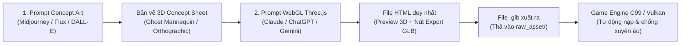

# Wuxing Skills — Modular Asset Master Index

Hệ thống quản lý prompts chuyên dụng để tạo mô hình 3D cho các trang phục, thân thể, binh khí và hoạt ảnh võ hiệp chuẩn AAA (Three.js WebGL -> GLB -> C99 Engine).

> [!NOTE]
> Toàn bộ các prompts đã được module hóa và chia tách thành từng file độc lập dưới thư mục [`raw_asset/prompts/`](file:///Users/mth2610/Desktop/c_games/wuxing_skills/raw_asset/prompts/). Mỗi file bao gồm đầy đủ **Prompt 1 (Concept Art)** và **Prompt 2 (WebGL Three.js Generator)**.

---

## Danh Mục Prompts Từng Bộ Phận

| # | Hạng Mục | File Prompt Chi Tiết | File Xuất (.glb) | Slot Trang Bị | Dạng Gắn Kết |
|---|---|---|---|---|---|
| **00** | **Quy Chuẩn Chung** | [`prompts/00_standards.md`](file:///Users/mth2610/Desktop/c_games/wuxing_skills/raw_asset/prompts/00_standards.md) | — | Quy chuẩn toàn bộ | Tọa độ mét, 20 xương Mixamo |
| **01** | **Thân Thể Nam** | [`prompts/01_human_body.md`](file:///Users/mth2610/Desktop/c_games/wuxing_skills/raw_asset/prompts/01_human_body.md) | `human_body.glb` | `MODULAR_SLOT_BASE_BODY` | SkinnedMesh (20 xương) |
| **02** | **Nón Lá** | [`prompts/02_non_la.md`](file:///Users/mth2610/Desktop/c_games/wuxing_skills/raw_asset/prompts/02_non_la.md) | `non_la.glb` | `MODULAR_SLOT_HEADGEAR` | Rigid Socket (`mixamorig:Head`) |
| **03** | **Áo Giao Lĩnh** | [`prompts/03_ao_giao_linh.md`](file:///Users/mth2610/Desktop/c_games/wuxing_skills/raw_asset/prompts/03_ao_giao_linh.md) | `ao_giao_linh.glb` | `MODULAR_SLOT_TORSO` | SkinnedMesh (28 xương Cloth) |
| **04** | **Quần Võ Hiệp** | [`prompts/04_quan_wuxia.md`](file:///Users/mth2610/Desktop/c_games/wuxing_skills/raw_asset/prompts/04_quan_wuxia.md) | `quan_wuxia.glb` | `MODULAR_SLOT_LEGS` | SkinnedMesh (20 xương) |
| **05** | **Chiến Hài Vân Du** | [`prompts/05_giay_wuxia.md`](file:///Users/mth2610/Desktop/c_games/wuxing_skills/raw_asset/prompts/05_giay_wuxia.md) | `giay_wuxia.glb` | `MODULAR_SLOT_BOOTS` | SkinnedMesh (20 xương) |
| **06** | **Hộ Uyển Cổ Tay** | [`prompts/06_ho_uyen.md`](file:///Users/mth2610/Desktop/c_games/wuxing_skills/raw_asset/prompts/06_ho_uyen.md) | `ho_uyen_*.glb` | `MODULAR_SLOT_BRACERS` | Rigid Socket (`ForeArm`) |
| **07** | **Thuận Thiên Kiếm** | [`prompts/07_kiem_thuan_thien.md`](file:///Users/mth2610/Desktop/c_games/wuxing_skills/raw_asset/prompts/07_kiem_thuan_thien.md) | `kiem_thuan_thien.glb` | `MODULAR_SLOT_WEAPON_R` | Rigid Socket (`RightHand`) |
| **08** | **Bộ Hoạt Ảnh Võ Thuật** | [`prompts/08_combat_moves.md`](file:///Users/mth2610/Desktop/c_games/wuxing_skills/raw_asset/prompts/08_combat_moves.md) | `combat_moves.glb` | Animation Bank | Shared Humanoid Clips |

---

## Quy Trình Sản Xuất 2 Bước (2-Step Asset Workflow)

1. **Bước 1 — Tạo bản vẽ Concept Sheet:**
   - Mở file prompt tương ứng (ví dụ: [`prompts/05_giay_wuxia.md`](file:///Users/mth2610/Desktop/c_games/wuxing_skills/raw_asset/prompts/05_giay_wuxia.md)).
   - Copy mục `X.1. Prompt Tạo Ảnh Thiết Kế Concept 3D` dán vào Midjourney / Flux để tạo ảnh concept đa góc nhìn.
2. **Bước 2 — Sinh ứng dụng Three.js xuất GLB:**
   - Kèm ảnh concept vừa tạo, copy mục `X.2. Prompt Lập Trình WebGL / Three.js` dán vào Claude / ChatGPT / Gemini.
   - Nhận về file `index.html`, mở trực tiếp trên trình duyệt, kéo các thanh slider để thử nghiệm khớp co gập.
   - Bấm nút **"EXPORT GLB"** để tải file `.glb` về máy.
3. **Bước 3 — Nạp vào Game Engine:**
   - Thả file `.glb` vào thư mục tương ứng trong `raw_asset/` (hoặc `assets/characters/`).
   - Engine tự động áp dụng cơ chế **Selective Body Deflation** (tự động thu nhỏ phần thân trong áo và phần đùi trong quần), đảm bảo **100% không xuyên áo/quần khi vận động**.
