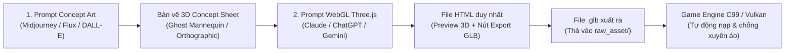

# Wuxing Skills — Modular Asset Master Index

Hệ thống quản lý prompts chuyên dụng để tạo mô hình 3D cho các trang phục, thân thể, binh khí và hoạt ảnh võ hiệp chuẩn AAA (Three.js WebGL -> GLB -> C99 Engine).

---

## Danh Mục Prompts Từng Bộ Phận

| # | Hạng Mục | File Prompt Chi Tiết | File Xuất (.glb) | Slot Trang Bị | Dạng Gắn Kết |
|---|---|---|---|---|---|
| **00** | **Quy Chuẩn Chung** | [`00_standards.md`](file:///Users/mth2610/Desktop/c_games/wuxing_skills/raw_asset/prompts/00_standards.md) | — | Quy chuẩn toàn bộ | Tọa độ mét, 20 xương Mixamo |
| **01** | **Thân Thể Nam** | [`01_human_body.md`](file:///Users/mth2610/Desktop/c_games/wuxing_skills/raw_asset/prompts/01_human_body.md) | `human_body.glb` | `MODULAR_SLOT_BASE_BODY` | SkinnedMesh (20 xương) |
| **02** | **Nón Lá** | [`02_non_la.md`](file:///Users/mth2610/Desktop/c_games/wuxing_skills/raw_asset/prompts/02_non_la.md) | `non_la.glb` | `MODULAR_SLOT_HEADGEAR` | Rigid Socket (`mixamorig:Head`) |
| **03** | **Áo Giao Lĩnh** | [`03_ao_giao_linh.md`](file:///Users/mth2610/Desktop/c_games/wuxing_skills/raw_asset/prompts/03_ao_giao_linh.md) | `ao_giao_linh.glb` | `MODULAR_SLOT_TORSO` | SkinnedMesh (28 xương Cloth) |
| **04** | **Quần Võ Hiệp** | [`04_quan_wuxia.md`](file:///Users/mth2610/Desktop/c_games/wuxing_skills/raw_asset/prompts/04_quan_wuxia.md) | `quan_wuxia.glb` | `MODULAR_SLOT_LEGS` | SkinnedMesh (20 xương) |
| **05** | **Chiến Hài Vân Du** | [`05_giay_wuxia.md`](file:///Users/mth2610/Desktop/c_games/wuxing_skills/raw_asset/prompts/05_giay_wuxia.md) | `giay_wuxia.glb` | `MODULAR_SLOT_BOOTS` | SkinnedMesh (20 xương) |
| **06** | **Hộ Uyển Cổ Tay** | [`06_ho_uyen.md`](file:///Users/mth2610/Desktop/c_games/wuxing_skills/raw_asset/prompts/06_ho_uyen.md) | `ho_uyen_*.glb` | `MODULAR_SLOT_BRACERS` | Rigid Socket (`ForeArm`) |
| **07** | **Thuận Thiên Kiếm** | [`07_kiem_thuan_thien.md`](file:///Users/mth2610/Desktop/c_games/wuxing_skills/raw_asset/prompts/07_kiem_thuan_thien.md) | `kiem_thuan_thien.glb` | `MODULAR_SLOT_WEAPON_R` | Rigid Socket (`RightHand`) |
| **08** | **Bộ Hoạt Ảnh Võ Thuật** | [`08_combat_moves.md`](file:///Users/mth2610/Desktop/c_games/wuxing_skills/raw_asset/prompts/08_combat_moves.md) | `combat_moves.glb` | Animation Bank | Shared Humanoid Clips |

---

## Quy Trình Sản Xuất 2 Bước (2-Step Asset Workflow)

